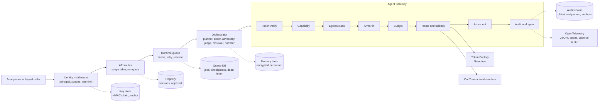

# Borges — architecture

## 1. Shape of the system

```
 React app (Vite, TS, D3)  ──SSE /api/runs/{id}/events──►  FastAPI (borges.api)
        ▲                                                      │
        │ static build served by FastAPI                       ▼
        │                                         RunOrchestrator (borges.runs)
        │                                                      │
        │      ┌───────────────┬──────────────────┬────────────┴──────────┐
        │      ▼               ▼                  ▼                       ▼
        │  analysis.*      garden.*           llm.*                  sandbox.*
        │  planner         executor           LLMClient              BranchBackend
        │  coder           search             nebius / scripted      local / contree
        │  adversary       influence          disk cache, spend      checkpoint fork
        │  judge           verify             guard
        │  narrator
        └── runs/<id>/events.jsonl  (every run is an append-only event log; replay = re-stream)
```

One Python package `borges` (in `src/borges`), domain-driven: each domain owns its models,
logic and tests. Files stay under ~200 lines. The frontend lives in `frontend/` and is built
into `frontend/dist`, which FastAPI serves at `/`.

## 2. Domains

| Domain | Responsibility | Key files |
|---|---|---|
| `analysis` | The plan (steps, options, decision rule), the LLM roles that create and judge it, the harness that turns an option into executable code | `models.py`, `planner.py`, `coder.py`, `adversary.py`, `judge.py`, `narrator.py`, `code_guard.py`, `code_guard_introspection.py`, `harness.py`, `profile.py` |
| `garden` | Universes, prefix-shared execution, bounded flip search, influence, verification | `models.py`, `executor.py`, `search.py`, `influence.py`, `verify.py` |
| `sandbox` | Branchable execution backends behind one protocol | `backend.py`, `local_backend.py`, `contree_backend.py`, `factory.py` |
| `llm` | Role-based model routing, structured JSON output, disk cache, cost accounting, hard spend cap | `client.py`, `nebius_provider.py`, `scripted_provider.py`, `cache.py`, `spend.py`, `json_output.py`, `factory.py` |
| `runs` | Orchestration, event bus, run store, replay, state folding | `events.py`, `orchestrator.py`, `bus.py`, `store.py`, `replay.py`, `state.py` |
| `memory` | Long-term memory per tenant and dataset fingerprint: SQLite repository, AES-GCM sealing, retrieval by signature then similarity, registry approval check, Armor screening | `repository.py`, `session.py`, `run_memory.py`, `signatures.py`, `seal.py`, `service.py` |
| `cases` | Curated demo cases (dataset + pinned plan + hand-built scripted model responses) | `registry.py`, plus `cases/<id>/` data folders |
| `api` | HTTP + SSE + static UI | `app.py`, `routes_*.py`, `run_policy.py`, `live_rules.py` |

## 3. The execution model (the core idea)

**Option code contract.** Each option is a Python function body. Non-final steps implement
`def apply(df, ctx) -> df`. The final step (`kind == "model"`) implements
`def estimate(df, ctx) -> dict` and returns `estimate, ci_low, ci_high, p_value, n`.
`ctx` is a JSON-serialisable dict that carries decisions forward (e.g. a covariate list
chosen at step 3 and read by the model at step 5). Allowed imports: pandas, numpy,
scipy(.stats), statsmodels(.api/.formula.api), math. `code_guard` enforces this with an AST
allowlist. The guard is default-deny (underscore attributes, frame and traceback
attributes, `type`, `getattr`, `exec`, computed string subscripts) and is the first layer
only: a lint that stops accidents and the bypasses reviewers have found (covered by
`tests/analysis/test_code_guard_introspection.py` and, for formula strings, by
`code_guard_formula.py`). It is a pattern check on source text and is not claimed to be
complete. The second layer is the runtime policy below; the isolation boundary is the VM
backend and the server policy (section 7).

**Runtime policy.** `harness.render_step` embeds `analysis/runtime_policy.py` as the first line of
every step file (`exec(compile(repr))`), so a PEP 578 audit hook is installed before any
generated code runs, in the same process and the same code on the local backend and on
ConTree. A denied event raises `PermissionError: runtime policy denied <event>` (patsy wraps
it as `PatsyError`); the message carries no host path. Tracebacks shift by one line.
- Blocked (tested): process creation (`subprocess.Popen`, `os.system`, `os.exec*`,
  `os.spawn*` through `os.fork`, `posix_spawn`, `fork`, `forkpty`, `pty.spawn`, and a direct
  `_posixsubprocess.fork_exec` call, which has no audit event and is stubbed in the prelude
  with its re-import denied); network
  (`socket` connect, bind, getaddrinfo, sendto, sendmsg, gethostby*, getnameinfo, getservby*;
  `urllib` fails through these); `webbrowser.open`; all `ctypes.*` events and the import of
  `cffi`, `_cffi_backend` and `_posixsubprocess`; write, append, create or truncate
  opens, `remove`, `rename`, `rmdir`, `mkdir`, `symlink`, `link`, `truncate`, `chmod`,
  `chown`, `chroot` and `shutil.rmtree/move/copyfile/copytree` outside the step's working
  directory (`/dev/null` excepted); `os.chdir` out of it, including `..`; registering a later
  audit hook (silently refused, because CPython swallows the exception). Paths are resolved by the policy's own symlink walk, not `realpath`.
- Reads are an allowlist (events `open` in read mode, `os.listdir`, `os.scandir`): the working
  directory, the Python roots (`sys.prefix` family, `sysconfig` paths, `sys.path` directories
  outside the home), system library roots, `/proc/<own pid>/` and a few device and time files.
  Always denied, before any allow rule: `.env` and `.env.*`, `/proc/*/environ`, `mem`, `maps`
  and other pids' `/proc` entries, and everything under the real user's home outside the
  working directory and Python roots. Writes stay confined to the working directory (`state/`,
  and `tempfile` through `TMPDIR=<fs>`, set by `LocalBackend._env`). Full list: `SECURITY.md`.
- Not covered: native-code exploits in C extensions; CPU and memory abuse beyond rlimits
  (CPU 600 s, file size 256 MB, 1024 processes, address space 3072 MB on Linux only) and the
  120 s step timeout; anything inside the read allowlist (installed packages, system roots); threads and
  signals; a primitive that CPython does not audit. `import ctypes` succeeds (pre-imported)
  but every `ctypes.*` event is denied. It is defense in depth under the guard, not VM or
  container isolation, so the local backend is not an isolation boundary.
- Cost: one statsmodels OLS step through `LocalBackend`, median of 10 runs (2 Oct 2026, macOS):
  0.925 s without the policy, 1.015 s with it (about +0.09 s, +10%).
- Evidence: `tests/sandbox/test_runtime_policy*.py` (127 collected test cases, three real exploits through
  the harness and `LocalBackend.run` without the guard); the four curated cases reproduce the
  recorded universes, checkpoints and flips under the policy. Proven on the local backend
  only: under ConTree the same prelude is embedded, and ConTree has since run against the real service
  (`tests/sandbox/test_contree_live.py` passed in 41.8 s on 2 October 2026), but the policy tests themselves run on the
  local backend.

**Harness.** `harness.render_step(step, option)` produces a self-contained script. It
loads `state/df.parquet` (or the root `data.parquet` on the first step) and `state/ctx.json`,
runs the option, writes the state back, and prints machine-readable lines:
`BORGES_TRACE {...}` with row counts, and on the final step `BORGES_RESULT {...}`. State lives
on the filesystem because ConTree checkpoints capture the filesystem, not RAM.

**Checkpoints.** The sandbox root holds the dataset and is checkpoint `R`. Running step *i*
with option *o* on checkpoint *P* yields a new checkpoint. A universe is a full choice vector
`{step_id: option_id}`. Its path is the chain of checkpoints for its successive prefixes.

**Prefix sharing.** `garden.executor` keeps `prefix -> Checkpoint`, with a per-key async lock
so concurrent universes never recompute a shared prefix. The baseline and all single-flip
universes share every checkpoint before the step they change.

**Search order** (bounded by `max_universes`):
1. baseline (all defaults);
2. single flips (one non-default option, defaults elsewhere);
3. adversary round: new options from real intermediate state, judged for defensibility,
   then single flips of the accepted ones;
4. combination flips, only while no flip has been found: a beam search by level. Level *k*
   extends every finished universe with *k − 1* changes by one more single change, ranks the
   candidates by the measured movement toward the opposite verdict of the parent plus that
   of the added change, and runs the top ten. It stops at the first level that flips, or
   when the universe budget is spent;
5. verification of the smallest flip found: re-execution from the root with no prefix cache, and
   the result must match exactly.

**Repeated units and seeded options.** The profile step records every identifier-like column
whose values repeat across rows (name reads as an id, code, num, key or short; at least 30
distinct values; at least 2 rows per value on average; see `analysis/repeated_units.py`). After
coding, each unit adds a pinned option "Cluster the errors by <unit>" to the model step, whatever
the planner proposed (`analysis/seeded_options.py`). It carries the default model's own code and
the unit's name in `Option.cluster_by`; the harness (`analysis/harness_cluster.py`) then fits every
statsmodels OLS, WLS, GLM, Logit, Probit, Poisson or NegativeBinomial of that step with
cluster-robust errors, and fails the universe when it cannot, instead of reporting unclustered
errors. A pinned option needs no judge and no coder, and a failing one is not repaired by a model.
The report carries "rows repeat N <unit> values; errors not clustered by <unit> may be too narrow"
when the original analysis is not clustered.

**Smallest flip found** = the flipped universe with the fewest changes among those the capped search (ten combinations per level, `MAX_COMBINATIONS_PER_LEVEL`) explored; it is not a proven minimum. Ties go to the higher
minimum defensibility, then to the larger move of the estimate.

**Influence** of a decision = the mean absolute change in the estimate when that decision
alone is switched away from the default, all else held at defaults. This is an
interventional contrast under a fixed continuation protocol, not a causal claim about the
world.

## 4. Models and money

| Role | Model (Token Factory id) | Calls per run |
|---|---|---|
| planner | `nvidia/nemotron-3-super-120b-a12b` | 1 |
| coder | `nvidia/Nemotron-3_5-Lightning` (Nano and Super are allowed alternatives through `BORGES_CODER_MODEL`, never fallbacks) | 1 per option (+1 repair max) |
| adversary | `nvidia/nemotron-3-super-120b-a12b` | 1 |
| judge | `nvidia/nemotron-3-super-120b-a12b` | 1 per adversary option |
| reviewer | `nvidia/nemotron-3-super-120b-a12b` | 1 per option, adversary options included |
| narrator | `nvidia/Nemotron-3-Ultra-550b-a55b` | 1 |

**Live cost, measured on 4 October 2026** (`evidence/live-runs.md`): a complete live run of one
case cost $0.0225 to $0.0408 (23 to 40 calls, 59k to 132k input tokens). On 2 October the
development day made 45 live runs, 31 completed, $0.65 recorded and $0.76 in the spend ledger
with the smoke checks. The scripted runs report 0 tokens and $0. Money controls:
- a content-addressed disk cache (`.borges/llm-cache/`), so repeated development runs are free;
- a persistent spend ledger (`.borges/spend.json`) with a hard cap (`BORGES_SPEND_CAP_USD`),
  which raises before any call that would exceed it;
- tests and the offline demo use the scripted provider and cost nothing;
- `max_tokens` is set on every call.

## 5. Events (the contract between backend and UI)

Every run is an append-only stream of `{seq, ts, run_id, type, data}`. The UI folds events
into state, and replay is the same stream re-emitted from `runs/<id>/events.jsonl`. Types are
defined in `borges/runs/events.py` and mirrored in `frontend/src/shared/types/contracts.ts`.

Payloads (`data`), always JSON from `model_dump(mode="json")`:

| type | data |
|---|---|
| `run.started` | `RunStartedData` |
| `stage` | `StageData` |
| `plan.ready` | `{"plan": AnalysisPlan}` |
| `option.coded` | `OptionCodedData` |
| `option.proposed` | `{"step_id": str, "option": Option}` |
| `option.judged` | `OptionJudgedData` |
| `memory.used` | `MemoryUsedData` (mode, reused and stored counts per kind, source runs) |
| `checkpoint.created` | `CheckpointCreatedData` (root: `parent_id`, `step_id`, `option_id` null, `depth` 0) |
| `universe.started` / `universe.finished` | `{"universe": Universe}` |
| `flip.found` / `flip.verified` | `{"flip": Flip}` |
| `usage` | `UsageData` |
| `report.ready` | `{"report": Report}` |
| `run.finished` | `RunFinishedData` |
| `run.failed` | `RunFailedData` |

`borges.garden.executor.GardenExecutor` emits `checkpoint.created`, `universe.started` and
`universe.finished`. `borges.runs.orchestrator` emits everything else.

## 6. Demo (what the judges see)

1. **Landing.** A plain pitch sentence and a "Watch the 30-second demo" button above the
   fold, four case cards (checkout A/B test, red cards, MARP religiosity, MARP cultural
   norms) and a bring-your-own-data card that is disabled, with the reason, unless
   `/api/health` reports `uploads_available`. Unknown runs, cases and URLs show a not-found
   page with links home.
2. **Live garden.** A radial labyrinth grows from the dataset at the centre: one ring per
   step, one branch per option, every node a real sandbox checkpoint. Counters show
   universes, forks, tokens and dollars.
3. **The flip.** The verdict card turns from SHIP to DON'T SHIP, the smallest-flip path lights
   up, and the justification and its source appear.
4. **Step into the universe.** A drawer shows the exact code, row counts at each step, the
   result, the checkpoint ids, the judge score (or "planner option, not judged") and a
   reproduce command computed by the server at read time: `borges reproduce --case C
   --universe U` for recorded demos, `python borges_<run>_<u>.py --data <file>` plus a
   script download (`GET /api/runs/{run}/universes/{u}/script`) otherwise. `borges
   reproduce` re-executes the universe on the case data with the local backend and exits 1
   with `MISMATCH` unless estimate, interval, p-value, n and verdict equal the recording.
   A flip that did not reproduce is marked as unconfirmed.
5. **Specification curve.** Every universe's estimate with its CI against the decision
   threshold, axes labelled. Cases with a reference (red cards, both MARP cases) show the
   human teams' results in a lane. The verdict card shows the flip kind (direction or
   significance), the effect range over the explored universes and the search-bias caveat.
6. **Decision influence.** The decisions ranked by how much they move the answer.

## 6b. Runtime: queue, leases, resume

`src/borges/runtime/` runs every API run through a durable SQLite queue (WAL, under `BORGES_HOME`).

- **Submit.** `POST /api/runs` registers the run as `queued` and inserts a job. The idempotency key is the
  `Idempotency-Key` header (24 h, per principal) or, without it, principal plus request hash within
  `BORGES_IDEMPOTENCY_WINDOW_S` (600 s). A duplicate returns the existing run with `Idempotent-Replay: true`.
- **Claim.** A worker claims a job with a lease (`BORGES_JOB_LEASE_S`) and renews it by heartbeat. The
  total, live and per-owner caps are checked at claim time; a job over a cap stays queued. An expired lease
  is reclaimed; a lease whose owner process is dead on this host is expired at startup.
- **Checkpoints.** Each finished universe and the plan and coded stages are written to the `checkpoints`
  table. On resume, finished universes are restored instead of re-executed and the earlier stages are
  replayed from the LLM cache, with events already persisted deduplicated. In-flight universes, orphan
  checkpoint events and terminal events are dropped from the log (sequence gaps, ids stay unique) and a
  `run.resumed` event is appended. The baseline sandbox state is rebuilt silently. Smoke-test state cannot
  be serialized, so the pre-search stages depend on the cache and are not free without it.
- **Retry.** Transient failures (5xx, 429, connection and timeout errors, sandbox unavailable) retry with
  backoff `base * 2**(attempt-1)` capped at 300 s, up to `BORGES_JOB_MAX_ATTEMPTS`, then land in
  `dead_letter` (`GET /api/runs/dead-letter`, admin; `borges runs retry <run_id>`).
- **Cancel.** `POST /api/runs/{id}/cancel`: creator, an admin, or an anonymous caller from the same client
  session. The run stops at the next checkpoint, emits `run.cancelled` and releases spend reservations.
- **Schedules.** `borges schedule add --case X --every 24h`; the loop runs only with `BORGES_SCHEDULER=true`.
  `GET /api/schedules` (admin). Minimum period 60 s; each slot is idempotent.
- **Health.** `GET /api/health` adds `queue_depth`, `active_workers`, `oldest_job_age_s`, `dead_letter_count`.

## 6c. Memory bank

`src/borges/memory/` is read once per kind at the start of a run and written once at the end.

- **Keys.** Tenant (key name, or `public-demo`), dataset fingerprint (sha256 of rows, dtypes, missing counts
  and summaries; not name, notes or samples), family fingerprint (column names and dtypes) and a signature
  per kind. Verdict and adversary signatures hash the question, estimand, step kind, conventional labels,
  column notes and the option label and spec; code signatures hash what the coder is told.
- **Use.** `judge_plan_options` and the adversary round ask `RunMemory` before calling the judge;
  `prefill_code` fills remembered code into options before `code_plan`, so the guard and the smoke test
  still run; the adversary prompt gets an avoid list and proposals rejected before are dropped; owner notes
  are merged into column notes before the profile is screened. `Pipeline.run` flushes in a `finally` and
  emits `memory.used`.
- **Not used.** Resumed runs, runs of a tenant without storage, a memory from the same run, a memory whose
  agent version is no longer approved, and anything Armor drops.

## 6d. Request path and stores

Every request is identified before it is routed, every run goes through the queue, and every model
or sandbox call goes through the gateway. The seven enterprise pillars are the labelled parts.
`GET /api/platform` and the `/platform` page report the live state of each one.



| Stage | Code | What it decides |
|---|---|---|
| Identity middleware | `identity/middleware.py`, `route_table.py` | Resolves `Authorization` to a principal; an undeclared route is denied; rate limits and failed-key throttling |
| Runtime queue | `runtime/` | Idempotency, caps at claim time, lease and heartbeat, resume, dead-letter |
| Gateway | `gateway/core.py`, `llm_route.py`, `sandbox_route.py` | Agent token and capability, egress class, budgets, route and fallback chain, audit |
| Armor | `armor/` | Screens run inputs, uploads, model input and model output |
| Registry | `fleet/` | Which agent versions are approved to run live |
| Stores | `BORGES_HOME/` | `identity/keys.jsonl`, `fleet/registry.jsonl`, the queue and memory SQLite files and the global audit log; each chained store has an anchor file |

## 7. Run modes

- `llm=scripted`: deterministic hand-built responses from `cases/<id>/fixtures/`, labelled
  `scripted`, 0 tokens, $0. Used by tests, CI and the offline demo.
- `llm=nebius`: live Nemotron through Token Factory, with cache and spend cap. Ran live for
  all six cases on 4 October 2026. `make live-smoke` checks the ids and one call per role;
  `make record-live` records the cases under `BORGES_RUN_CAP_USD` into
  `cases/<id>/recorded-live/` and never overwrites `recorded/`. `borges reproduce --source
  live` re-executes a universe of those recordings.
- `backend=local`: a directory per checkpoint (copy-on-write clone where available) and a
  subprocess with timeout, resource limits, a scrubbed environment, the AST guard and the
  runtime audit-hook policy. It is not an isolation boundary (reads are allowlisted but the
  allowed roots stay readable, and native code is not audited). Used for development, CI and
  scripted demos on a private or disposable machine.
- `backend=contree`: Nebius Token Factory Sandboxes. Each step is `image.run(...,
  disposable=False)` on the parent image. VM isolation; contract-tested with a fake SDK, and run against the
  real service on 2 October 2026: the live test passed in 41.8 s, a scripted `checkout_ab` run
  (`r_20261002T155240_392c19`) made 22 real ConTree checkpoints and found the same flip as the local backend, and a
  live `marp_religiosity` run on Nemotron plus ConTree (`r_20261002T155440_0aa541`) completed 16 universes.
- `replay`: re-stream a recorded run, with no models and no sandboxes.

The run header shows the mode of each run (`Scripted replay` or `Live on Nemotron`, plus the
backend), taken from `run.started`. The landing footer follows `/api/health`.

### Public deployment

There is no hosted demo yet. A public instance plays the live recordings (and the scripted
replays, which are hand-built, not model runs) on the local backend, and should run live or upload workloads only on
`BORGES_BACKEND=contree`. The server, not the client, chooses the backend. `POST /api/runs` applies a policy: it clamps
`max_universes` to `BORGES_MAX_UNIVERSES`, answers 429 when `BORGES_MAX_ACTIVE_RUNS` runs are
active or `BORGES_MAX_LIVE_RUNS` live runs are active, and rejects live runs when there is
no key (400) or the spend cap is used up (403). `/api/health` reports
`llm_live_available` and `live_unavailable_reason` (`no_key` or `budget_spent`), and the
case cards disable the live button with that reason. It also reports `uploads_available` and
`uploads_unavailable_reason`, derived by `api/live_rules.py` with the same rules the policy
uses. Uploads (CSV or parquet) need live mode; the local backend refuses them (400) unless
`BORGES_ALLOW_UNTRUSTED_LOCAL=true` (only `make dev` sets it), and when `BORGES_LIVE_TOKEN` is set the header
`X-Borges-Live-Token` must match it (the built-in UI does not send it). Live runs on a
curated case are not refused on the local backend by the policy; that combination must not
be exposed publicly.

| Variable | Public instance |
|---|---|
| `BORGES_ALLOW_UNTRUSTED_LOCAL` | `false` (the image default). `make dev` sets `true`; `make serve` does not. |
| `BORGES_BACKEND` | `contree` if uploads should run live; `local` otherwise. |
| `BORGES_LIVE_TOKEN` | Set it to gate uploads. |
| `BORGES_MAX_ACTIVE_RUNS`, `BORGES_MAX_LIVE_RUNS` | Concurrent run limits (defaults 2 and 2). |
| `NEBIUS_PROJECT_ID` | Token Factory project for Sandboxes, required by the contree backend (`CONTREE_PROJECT_ID` overrides it). |
| `/app/.borges` volume | Holds `spend.json` and the LLM cache; without a volume the spend ledger resets on every redeploy. |

CI (`.github/workflows/ci.yml`) runs ruff, pytest and the frontend typecheck, tests and
build on every push. `runs/` is not part of the image, so run ids vanish on redeploy; the UI says so when it
opens a run that no longer exists.

## 8. Exact formats shared by several domains

**`Option.code`** is complete Python source that defines exactly one function:
- `apply(df, ctx)` returning a DataFrame, for steps of kind `filter`, `transform` and
  `feature`;
- `estimate(df, ctx)` for the step of kind `model`, returning a dict with float keys
  `estimate`, `ci_low`, `ci_high`, `p_value`, an int `n`, and an optional
  `extra: dict[str, float]`.

Top-level `import`/`from` of allowed modules is permitted; any other top-level statement
is rejected by `code_guard`. `ctx` may be mutated in place (it is persisted as JSON after
every step). Functions must be deterministic: any randomness uses a fixed seed.

**Case folder** `cases/<case_id>/`:
- `case.json`: a `CaseSpec`;
- `data.parquet`: the dataset;
- `fixtures/`: the scripted model responses;
- `recorded/events.jsonl`: optional, a scripted recording for offline replay;
- `recorded-live/events.jsonl`: the live Nemotron recording, played by default by the web app;
- `live_only` in `case.json` (default false): a live-only case has no `fixtures/` and no
  scripted recording (only `recorded-live/`), runs only with `llm=nebius`, and the registry refuses a scripted run with a clear
  message (`CaseRegistry.require_scripted`).

**Scripted fixtures.** A request `key` maps to the file `fixtures/<key with ":" replaced by
"__">.json`, holding `{"model": str, "text": str, "parsed": object|null, "tokens_in": int,
"tokens_out": int}`. Keys:
- `planner` (parsed = `PlannerOutput`);
- `coder:<step_id>.<option_id>` (parsed = `CoderOutput`);
- `coder:<step_id>.<option_id>:repair` (parsed = `CoderOutput`);
- `adversary` (parsed = `AdversaryOutput`);
- `judge:<step_id>.<option_id>` (parsed = `JudgeOutput`);
- `narrator` (parsed = `NarratorOutput`).

Hand-built fixtures carry `"model": "scripted"` (MARP: `scripted-fixture`) and 0 tokens;
scripted calls report `cost_usd = 0` and 0 tokens. A live run with
`record_dir` writes exactly this format, so any live run can be replayed deterministically
afterwards.
