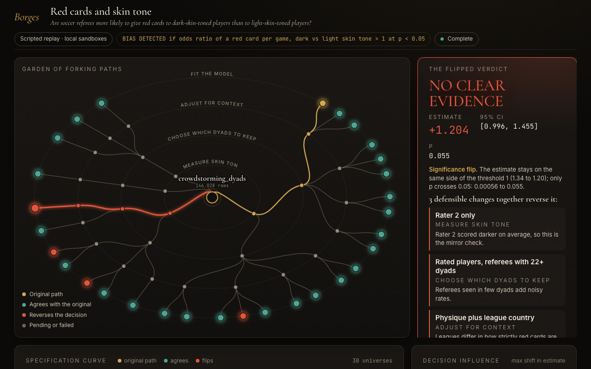
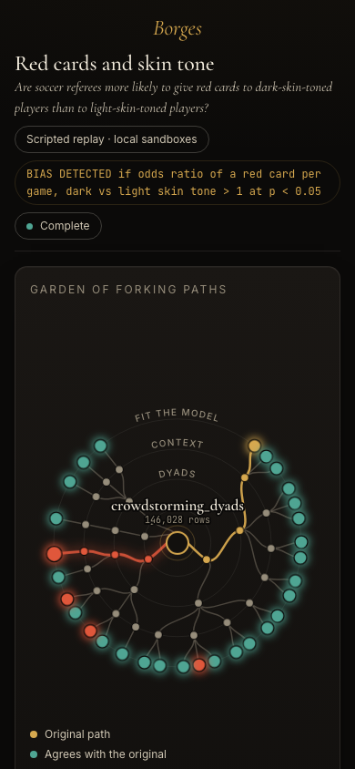

# Borges

**How fragile or robust is this decision, and which analytic choice matters? Borges re-runs
the analysis along other defensible paths, tells you how many agree with yours, and shows the
smallest flip it found.**

> ## Judge it in 2 minutes
>
> **What Borges answers:** how fragile or robust a data decision is, and which analytic choice
> moves it. It leads with the share of the analysis grid that agrees with yours ("60% of the
> analysis grid agrees", with the explored paths as context; "N of M paths are also
> inconclusive" when your own result is not significant), then the smallest flip it found and
> which kind it is: a *direction* flip (the sign reverses) or only a *significance* flip (same
> sign, p crosses 0.05).
>
> - Hosted demo: TODO-OWNER (URL, none exists yet)
> - Video: TODO-OWNER (link, not recorded yet)
> - Offline, no key, from a fresh clone (Python 3.13 and [uv](https://docs.astral.sh/uv/)):
>
> ```bash
> uv sync
> uv run borges replay --case checkout_ab
> uv run borges reproduce --case checkout_ab --source live --universe u_fb948f9bb7
> uv run borges run --case marp_norms --llm scripted
> ```
>
> The first prints the live Nemotron recording of the checkout case, the one the web app plays:
> the verdict, the smallest flip, the models and the estimated cost, read from the committed
> events, with no model called. Its last two lines are exactly (a test runs the command and
> compares them with this block):
>
> ```text
> Universes: 16, checkpoints: 39, LLM calls: 41 (0 cached)
> Tokens: 84125 in / 8316 out, estimated cost: $0.0291 (token counts x list prices, not a billed amount)
> ```
>
> The second re-executes that recording's flipping universe and prints `MATCH` when the result
> equals the recording (`make demo-live` runs both). The third runs the whole pipeline offline
> on hand-built model responses: the data, the code and every statistic are real, no model
> wrote the plan. Its last two lines are exactly:
>
> ```text
> Universes: 40, checkpoints: 171, LLM calls: 38 scripted (0 cached)
> Tokens: 0 in / 0 out, cost: $0.0000 (scripted replay, no model called)
> ```
>
> Nine cases were recorded live on ConTree sandboxes from an empty cache, six on 5 October
> 2026 ($0.026 to $0.056 each) and three on 7 October ($0.050, $0.067 and $0.080), token counts times
> list prices, not billed amounts; the web app plays those recordings by default. The status
> table below says what is and is not live.
>
> **The value:** one analysis is one path. Borges shows the other defensible paths, how many
> agree, and, with a calibration study (`evidence/calibration.md`), how much to trust a flip.

<p align="center"> </p>

<sub>Screenshots of the scripted replay of the red cards case (no model called); the drawer view is in `assets/screenshots/replay-drawer-1280.png`. The web app plays the live Nemotron recording by default.</sub>

In three lines:

1. You give it a dataset, a question and the rule you will act on ("ship if the lift is
   positive with p < 0.05").
2. Nemotron plans the analysis, every choice forks a real sandbox, and an adversary proposes
   paths against your conclusion.
3. You get the share of universes that agree, the decisions that move the result, the
   smallest flip found by a bounded search (and whether it reverses the sign or only crosses
   p = 0.05), and a command that reproduces it.

If you bring your own analysis in plain words, it is the starting point: the plan's default path
implements it, a second model checks that before anything runs, and the judge may dispute it but
not replace it. The question is then how fragile *your* analysis is
(`cases/fertility_published`). This path failed its held-out test on 9 October: on a published
analysis it was not developed on, it started from the published cell in 3 of 5 attempts and
found a confirmed flip in 1 (`evidence/held-out.md`).

Built for the [Nebius x NVIDIA Global AI Hackathon](https://nebiusglobalaihackathon.devpost.com/)
on **NVIDIA Nemotron 3** served by **Nebius Token Factory**. Every analysis step runs as a
branch of a sandbox: a local subprocess backend by default (no VM isolation), or Nebius
Token Factory Sandboxes (ConTree, VM-isolated) with `BORGES_BACKEND=contree`.

## Status: what has and has not run

Be clear about this before reading further. The source of truth for every live number is
[evidence/live-runs.md](evidence/live-runs.md).

| | State today |
|---|---|
| Nemotron through Token Factory | **Six cases ran live on 5 October 2026 (UTC)**, each from an empty model cache: four at commit `16f02e7`, red_cards at `5070877` and bank at `6317040` (the changes between them are listed in `evidence/live-runs.md`). 238 calls in all, an estimated $0.026 to $0.056 per case ($0.21 for the six), computed from token counts and list prices, not from invoices. Models: `nvidia/nemotron-3-super-120b-a12b` (planner, adversary, judge, repairer, reviewer), `nvidia/Nemotron-3_5-Lightning` (coder), `nvidia/Nemotron-3-Ultra-550b-a55b` (narrator). The coder was chosen by measurement (`evidence/coder-choice.md`); Nano and Super are allowed alternatives through `BORGES_CODER_MODEL`, never fallbacks. **Two more cases, whose published answers Borges is not told, ran live on 7 October** at `0859f2c` and `14adc35` ($0.050 and $0.067), with the judge and narrator on Ultra and the planner on Super (Ultra is its fallback; five fresh Ultra plans of the fertility case were all unusable) |
| ConTree sandboxes | **All nine recordings ran on ConTree** (`backend: contree` in each `recording.json`). Earlier, on 2 October 2026, `tests/sandbox/test_contree_live.py` passed in 41.8 s |
| What the web app plays | The live recordings in `cases/<case>/recorded-live/events.jsonl`, by default, under the banner "Recorded live on Nemotron via Nebius Token Factory, <date>: <calls> calls, <tokens> tokens, $<cost>". Each recording also has `spans.jsonl`, `audit.jsonl` and `recording.json`. A toggle switches to the scripted replay where one exists |
| Scripted replays | Still shipped: hand-built fixtures, not model output, labelled `scripted` (or `scripted-fixture`), 0 tokens and $0. The CLI says so: `cost: $0.0000 (scripted replay, no model called)`. They are the offline path and what the calibration and grid studies use |
| What is real | The data, the option code, the sandbox execution and every statistic. `borges reproduce --source live` re-executed the baseline and the flip (or the farthest universe) of all six recordings on macOS: 11 of 12 MATCH. The twelfth, a median regression recorded on ConTree's Linux, differs by 4e-6 relative, with the same p-value, n and verdict. MATCH proves the recorded code is deterministic. Correctness was checked separately: an auditor that did not read the code refitted every baseline and flip from the specs and the raw data, and all agree to 2e-7 (`evidence/refit.md`). That refit caught one wrong headline, bank's, which was fixed and recorded again. The two 7 October recordings reproduce 4 of 4 MATCH, and a refit caught a wrong coefficient in an earlier fertility recording, which was discarded (`evidence/live-runs.md`) |
| BLADE benchmark | Ran live on 4 October: mean F1 over 12 datasets 0.468 (planner arm) and 0.480 (adversary arm), one repeat each. The 0.012 difference is smaller than the gap between the two committed tables, and one repeat cannot show it is more than noise (`evidence/blade/README.md`) |
| Domain scenarios | **Eight synthetic datasets with a planted answer** (a fictional audit firm, a clinic, a K-12 district, a bank; two asked in Spanish) ran live on 9 October. First runs: 4 of 8 right. The gaps they exposed were fixed at the root and rerun: 7 of 8 right; the clinic case with a pre-existing time trend still overstates the effect about twofold (`evidence/domain-scenarios.md`). On 9 October Token Factory stopped serving Nemotron Ultra (404); the gateway falls back to Super for the judge and the narrator |
| Hosted public demo | **None yet**: no public URL, no video |
| Outside users | None. Nobody outside the project has used it, and no head-to-head against another tool exists |

The scripted recordings (`cases/*/recorded/events.jsonl`) still list the configured role model
ids in the `run.started` `models` field, even though no model was called; the `llm` field of
the same event says `scripted`.

### The live recordings

| Case | Original verdict | Smallest flip found | Universes |
|---|---|---|---|
| checkout_ab | SHIP: +0.85 pp [0.15, 1.55], p 0.017, n 16,000 users | Exclude the 171 internal sessions: -0.15 pp [-0.80, 0.50], DON'T SHIP (direction) | 16 |
| red_cards | BIAS DETECTED: OR 1.17 [1.05, 1.30], p 0.0046 | Dyads with at least 2 games together plus the 0.5 skin-tone threshold: OR 1.12 [0.98, 1.29], p 0.092, NO CLEAR EVIDENCE (significance only) | 22 |
| marp_religiosity | POSITIVE ASSOCIATION: 0.093 [0.076, 0.111] | none | 12 |
| marp_norms | DEPENDS ON NORMS: interaction 0.035 [0.018, 0.052] | none | 35 (6 failed) |
| bank_marketing_calls | CAP THE CALLS: OR 0.872 [0.857, 0.886] per call | none | 12 |
| hurricanes | NO CLEAR EVIDENCE: 0.011 on log1p(deaths) [-0.073, 0.094], p 0.80, n 93 | none | 18 |
| teaching_ratings | BEAUTY PREMIUM: 0.165 [0.103, 0.226], p 1e-7, n 463 | none | 20 |
| fertility_religiosity | NO CLEAR EVIDENCE: 0.27 [-2.05, 2.60], p 0.82, n 171 | none | 32 |
| fertility_published | FERTILITY SHIFTS RELIGIOSITY: 2.38 [0.53, 4.24], p 0.012, n 163, the published analysis | Committed = married only: 0.86 [-1.18, 2.90], p 0.40, NO CLEAR EVIDENCE (significance only) | 19 (5 failed) |

The numbers are rounded from the full values in `evidence/live-runs.md`, which also has the run
ids, tokens, costs and reproduce results. One run per case is one sample of a model. How often the
verdict and the flip recur is measured by five repeats per case in `evidence/repeats.md`. What the
recordings show:

- **checkout.** The plan aggregates sessions to users and keeps every session by default, which
  gives SHIP. Excluding the internal sessions gives DON'T SHIP, the planted answer, and the
  recording does not mark it contaminated. The column notes say internal sessions are not
  genuine customers, so the model had that hint. The blind runs, with the notes stripped, are in
  the repeats.
- **red cards.** BIAS DETECTED at OR 1.17, inside the 29 teams' range (0.89 to 2.93). The
  smallest flip takes two changes and crosses p = 0.05 only; the robustness share is 70%. That
  flip recurred in none of four repeats (BIAS DETECTED three times, NO CLEAR EVIDENCE once).
  With standard errors clustered by player, the original verdict holds: OR 1.17 [1.02, 1.35],
  p 0.028 (`evidence/refit.md`).
- **hurricanes.** The planner's only filter drops the deadliest storm (1,833 deaths). With it
  out, no universe finds feminine names deadlier. That is the outlier critique of the original
  study, and it came from one plan's choice.
- **bank.** No flip in 12 universes. The `5070877` recording had reported OR 0.907 from a model
  that weighted each client by the number of calls. The independent refit caught it, the harness
  now refuses that model, and the case was recorded again.
- **MARP.** No flip on either question.
- **teaching ratings and fertility (7 October).** Two published answers that Borges is not told.
  Teaching ratings is the robust one: BEAUTY PREMIUM at 0.165, Hamermesh and Parker's adjusted
  estimate on these data, and 0.133, their simple one, in the farthest universe; no flip in nine
  live runs. Fertility is the fragile one: Durante et al. reported p = .012, and Steegen et al.
  found p < .05 in 7 of 120 defensible processing choices. Borges says NO CLEAR EVIDENCE in all fifteen
  completed runs, but that does not reproduce Steegen's finding: 13 of the 15 plans counted the
  cycle day forward from the last period and the other two built "fertility" from cycle length
  alone; none counted back from the next expected period as Durante et al. and all 120 of
  Steegen's universes do, so no Borges universe lies in
  Steegen's grid and none reached its 7 significant cells. Borges shows that another defensible
  convention also gives no effect; it does not show the fragility those 7 cells show. One run
  rested on a result its code invented, which the code guard has refused since, and the three
  flips reported along the way do not stand (`evidence/repeats.md`). Two
  fertility recordings were discarded first: one reported a covariate's coefficient as the
  interaction (now refused), one built "high fertility" from days 0 to 9 of the cycle. The planner
  makes that construct error in about one fertility run in four, and neither the judge nor a
  dedicated auditor caught it reliably, so it stays a known limitation (`evidence/live-runs.md`).
- **fertility from the published analysis (7 October).** Given the analysis behind the published
  result, Borges starts exactly there (2.3834, p .012, n 163, Steegen et al.'s published cell)
  and finds a one-change flip in all three runs that measured it: committed = married only
  (p .40, the recording, and again in a third run) and single = not dating with dating women left
  out (p .12, Steegen's R3 cell to four decimals, proposed by the adversary). In the third run the
  adversary also shifted both fertility windows two days earlier (p .089), a flipping fork that is
  not in Steegen's grid. Steegen et al. found 6 of the 9 single changes lose significance; Borges
  finds a smallest flip and part of that region, not all of it. Of seven attempts, one was discarded because the planner rewrote "single = 1 or 2" and
  called it the user's definition; a fidelity check now compares the plan with the analysis
  before anything runs (`cases/fertility_published/README.md`, `evidence/repeats.md`).

### What the live runs taught us

The live batches of 2 to 5 October failed in ways the scripted demos could not show, and each
failure became a safeguard with a test. The full tables, with run ids and commits, are in
`evidence/live-runs.md`. In short:

- **Impossible intervals and estimates.** A standard error 50 times too small, a CI of
  [-341, +341] pp and a "flip" to -398,439. The smoke test now checks split-half standard errors
  and plausibility, and such universes fail instead of flipping.
- **Labels that did not match the estimator, and signs that meant nothing.** Estimator names are
  checked against what was fitted, and an orientation check fails reversed columns.
- **The model step was the weak link.** It passed its smoke run first try for 13% of 212 options.
  It is now rendered from a structured spec by tested templates, written by a coder chosen by
  measurement. Later failures were fixed in Borges, not by changing models: unit conversions
  (the code contract overrides the spec), Armor flagging Borges's own repair hint, a
  1,577-column dummy design (identifiers with hundreds of levels are refused), an offset used as
  the exposure, a four-level text exposure.
- **A step that loses every option** is re-planned once instead of killing the run, and a
  re-plan cannot bring back an option the judge rejected.
- **A number can match to 14 digits and still be wrong.** `reproduce` proves determinism, not
  correctness. The independent refit found bank's headline weighted by its own exposure, so the
  harness now fails that model. It also found an unrelated paper cited for a flip, so citations
  are now labelled as unchecked model output.
- **Honest reports.** A run where only the default analysis ran says robustness was not tested.
  Each caveat is reported once.

---

## The problem

In 2018, 29 research teams were given the same dataset and the same question: are soccer
referees more likely to give red cards to dark-skin-toned players? Their odds ratios ranged
from 0.89 to 2.93, and 20 teams found a significant effect while 9 did not. Nobody made a
mistake: they made different, defensible analysis choices
([Silberzahn et al., 2018](https://journals.sagepub.com/doi/10.1177/2515245917747646)).

AI analysts behave the same way
([Many AI analysts, one dataset, PNAS 2026](https://pmc.ncbi.nlm.nih.gov/articles/PMC13393493/)),
and more and more decisions rest on an analysis an AI wrote along a single path. It
returns one confident answer and never shows the paths it did not take.

## What Borges does

Give Borges a dataset, a question and the rule you will act on, for example *"ship if the
conversion lift is positive with p < 0.05"*.

1. **Nemotron plans the analysis like a senior statistician.** At every step where experts
   disagree it lists the defensible alternatives, and the conventional choice is the
   default.
2. **Every choice forks a real sandbox.** Each step runs in a sandbox (a subprocess on the
   local backend, a VM on ConTree). Each alternative branches from the exact filesystem
   state of the step before, and universes that share a prefix share its checkpoints.
3. **An adversarial analyst argues against your conclusion, with code.** It reads what the
   real data did at each step (row counts, the estimate) and proposes new options; an
   independent judge scores how defensible each one is, and only defensible ones enter the
   garden.
4. **Borges looks for the smallest defensible flip.** It tries one change, then two, then
   three (at most 10 combinations per level, those that moved the result closest to the
   threshold first), so the answer is the smallest flip a bounded search found, not a proven
   minimum. It re-executes the winning universe from a fresh sandbox to prove it reproduces (determinism of the recorded code, not statistical correctness).
5. **You can step into any universe** and see its exact code, row counts, checkpoint ids
   and result.

## The demo cases

The numbers in this section and in the next two come from the scripted replays of the hand-built
option spaces (the offline path). The live recordings above reached their own verdicts, for
example SHIP flipping to DON'T SHIP for the checkout case, and are summarised in the status section and
in `evidence/live-runs.md`.

| Scripted replay | Checkout A/B test (synthetic, effect planted) | Red cards (real data, 146,028 dyads) |
|---|---|---|
| Question | Does the new checkout increase conversion? | Do referees give dark-skinned players more red cards? |
| Default analysis | **SHIP**: +0.53 pp, 95% CI [0.14, 0.92], p = 0.008 | **BIAS DETECTED**: OR 1.34, 95% CI [1.13, 1.58], p = 0.0006 |
| Smallest flip found | 1 change: exclude internal test accounts | 3 changes together: the second rater only, referees with 22+ dyads, full covariates |
| Flipped result | **DON'T SHIP**: −0.14 pp, [−0.50, 0.21], p = 0.43 | **NO CLEAR EVIDENCE**: OR 1.20, [1.00, 1.46], p = 0.055 |
| Reproduced from scratch | yes | yes |
| Explored | universes and checkpoints: see the last lines printed by `make demo-cli` | same, `uv run borges run --case red_cards --llm scripted` |

**The checkout data is synthetic and the answer is planted.** `cases/checkout_ab/generate.py`
sets a true effect of -0.2 pp (`TRUE_EFFECT = -0.0020`), adds a +0.4 pp novelty bump to the
treatment arm on days 0-2 (`NOVELTY_BUMP = 0.004`) and adds internal test accounts (58%
conversion, assigned to treatment with probability 0.80). The plan is hand-written and finds exactly that flip, so this case shows the
mechanics, not discovery. The red-cards flip is a p-value crossing: the odds ratio goes from
1.34 to 1.20 and stays above 1, with p moving from 0.0006 to 0.055. The evidence weakens; the
effect does not reverse. The search favours flips, so this is the nearest crossing Borges
found, not a typical analysis. The robustness line the CLI prints (share of paths that agree, with the number of
universes and a rating only when there are enough of them) is the fairer headline. On the red-cards data no single or paired defensible change reverses the finding;
it takes three together. The only single change that would flip it, keeping low-bias referees
only, is rejected by the judge as an indefensible change of population.

### How wide is the curve, against the human teams

| | Borges universes | Reference teams |
|---|---|---|
| Red cards (odds ratio) | live recording, 22 universes: 1.09 to 1.24; scripted replay, 39 universes: 1.20 to 1.36 | 29 teams: 0.89 to 2.93, median 1.31, 20 significant. Two teams (Tobit 2.88, Poisson 2.93) are the extremes; the next highest is 1.71. Five teams fall inside the live range and ten inside the scripted one |
| MARP religiosity (standardised beta) | live recording, 12 universes: 0.045 to 0.107; scripted replay, 38 of 40 completed: 0.060 to 0.150; all 768 universes enumerated offline: 0.053 to 0.156 | 110 teams: 0.007 to 0.354, median 0.120, all 110 intervals above 0 |
| MARP cultural norms (interaction beta) | live recording, 29 of 37 completed: 0.034 to 0.048; scripted replay, 25 of 27 completed: 0.018 to 0.046; offline 1,536: -0.002 to 0.049 | 105 teams: -0.045 to 0.282, median 0.039, 68 of 105 above 0 |

Borges's range is narrower than the teams', and it should be. It walks defensible choices
under one estimand: the red-cards plan has four decisions (skin-tone measure, exclusions,
covariates, model family) and 72 base combinations plus the adversary's proposals, while the teams
also chose different outcomes and estimands (Tobit, zero-inflated and negative-binomial
count models, Dirichlet-process clustering, Spearman correlation) and added their own
covariates. The narrower curve answers "how fragile is this analysis within its own
question", not "how much would 29 independent teams disagree". On the real MARP data Borges
also agrees more than the teams do on the cultural-norms question (89% of the 1,536 enumerated universes
against 65% of the teams); the space holds the teams' common choices, not their tails.
Both case READMEs list what is outside the option space.

### A real business case, live only

`bank_marketing_calls` (UCI Bank Marketing, 45,211 phone-campaign records, CC BY 4.0) asks
whether each extra call to a customer lowers the chance of a term-deposit subscription.
Nothing is planted. It has no scripted fixtures, so it runs only with `llm=nebius`, and a
scripted run is refused with a clear message. Its only recording is the live one. Plain
logistic regressions by the author gave an odds ratio of 0.86 to 0.93 per extra call in nine
specifications. The final live run (33 calls, an estimated $0.0257) gave OR 0.8716 per call [0.8573, 0.8862],
CAP THE CALLS, and found no flip in 12 universes. An independent refit agrees to 3e-15. See
`cases/bank_marketing_calls/README.md`.

### Real, unplanted data: the MARP cases

`marp_religiosity` and `marp_norms` use the Many Analysts Religion Project (10,535
participants in 24 countries, CC-BY 4.0), with the per-team results as the reference lane.
Nobody planted anything. Religiosity and well-being is robust in this option space (no flip
in the 38 universes that completed of 40), with a disclosed caveat: well-being options are alternative measures of
overall well-being, and the physical-health facet alone is fragile (see
`cases/marp_religiosity/README.md`). The cultural-norms interaction has one single-change
flip, pooled OLS (p = 0.056, estimate still positive). These recordings are scripted
replays of a hand-built option space seeded from the teams' published choices; the adversary
proposes nothing there.

## How much to trust a flip

`evidence/calibration.md` (offline, scripted, 504 synthetic checkout datasets of about 30,000
sessions, the real pipeline, fixed menu of 5 steps x 2 options plus one scripted adversary
option, seeds `20261002 + cell_index * 1,000,000 + i`, Wilson 95% intervals; nothing live):

| Situation | Flip reported | Direction flip |
|---|---|---|
| Large true effect (0.010 absolute lift), no artefact, n = 80 | 13/80 = 16% [10, 26] | 0/80 [0, 5] |
| Null effect, default analysis wrongly says SHIP, n = 80 | 71/80 = 89% [80, 94] | 0/80 [0, 5] |
| Null effect with the planted artefact, n = 80 | 78/80 = 98% [91, 99]; via internal traffic 76/80 = 95% [88, 98] | 35/80 = 44% [33, 55] |
| True effect at 80% power with the artefact, n = 80 | via internal traffic 55/80 = 69% [58, 78] | 0/80 [0, 5] |

The uncomfortable conclusion: on clean data with a large true effect the search reports a
significance-only flip 16% of the time, and in 272 clean datasets it never reported a
direction flip (95% upper bound about 1.4%). A flip label must say which kind it is. A
significance flip is weak evidence (it is expected from noise near the threshold); a direction
flip is specific. The red-cards flips, scripted (OR 1.34 to 1.20) and live (1.17 to 1.12), are of
the weak kind. No flip does not
prove no artefact: detection falls as the true effect grows (95%, 69%, 21%). The rates apply to
this fixed menu, not to arbitrary datasets.

Against a fixed full grid (what a hand-written multiverse or specr would run over the same
seeded options), `evidence/grid_vs_search.md`: the grid ran 72, 32, 768 and 1,536 universes on
red cards, checkout, MARP religiosity and MARP norms (27, 12, 204 and 424 s offline) and found
the same smallest flip as Borges in all four cases, or none in either. Borges used 30, 7, 40 and
15 universes. The objections a statistician would raise, with answers, are in `PRODUCT.md`.

## Repeats, blind runs and what is still pending

Every case was run five more times live on 5 October, each from an empty cache
(`evidence/repeats.md`). 34 of 35 runs completed; the failed one was a red_cards run whose
model option asked for a "weighted" fit without naming the weight. The guard refused the code,
and the run stopped instead of reporting a number. Flip rates, with 95% Wilson intervals:

| Case | Verdicts over five runs | Runs that found a flip |
|---|---|---|
| checkout_ab | SHIP ×4, DON'T SHIP ×1 | 4/5 (0.38 to 0.96), each a direction flip from excluding internal sessions |
| checkout, column notes stripped (`--blind-notes`) | SHIP ×3, DON'T SHIP ×2 | 3/5 (0.23 to 0.88), each a direction flip from excluding internal sessions |
| red_cards | BIAS DETECTED ×3, NO CLEAR EVIDENCE ×1 (1 failed) | 0/4 |
| hurricanes | NO CLEAR EVIDENCE ×5 | 2/5 |
| bank_marketing_calls | CAP THE CALLS ×5 | 0/5 |
| marp_religiosity | POSITIVE ASSOCIATION ×5 | 0/5 |
| marp_norms | DEPENDS ON NORMS ×5 | 0/5 |

In all ten checkout runs, with or without the notes, the internal sessions were excluded. In
seven the plan started from keeping them (SHIP) and the smallest flip excluded them (DON'T
SHIP). In the other three, the planner excluded them by default, so the run started at DON'T
SHIP. The data has an `is_internal` column, so the column name alone is a hint; the blind runs
show that the notes are not needed. The verdict
itself varies between runs because the planner chooses the original analysis anew each time.
red_cards is the clearest case: it says BIAS DETECTED in three runs and NO CLEAR EVIDENCE in one.

Does the adversary add anything? `evidence/adversary-ablation.md` pairs every adversary universe
with its planner twin over three censuses (101 completed runs). The adversary was the only source
of a flip in 3 runs, and one of its options reversed the verdict by itself in 13. Mostly it
re-finds forks the planner already lists.

Still pending: a head-to-head against another tool, an outside user, and a hosted demo.

## Quickstart

Requirements: Python 3.13 with [uv](https://docs.astral.sh/uv/), Node 22+ with pnpm.

```bash
make install          # uv sync --extra contree, pnpm install
make demo-live        # the live checkout recording the web app plays, and its flip re-executed, $0
make demo-cli         # checkout case end to end on hand-built model responses, offline, $0
make demo-red-cards   # the live red-cards recording the web app plays, and its flip re-executed, $0
uv run --no-sync borges replay --case teaching_ratings   # any case's live recording, no model called
uv run --no-sync borges run --case marp_religiosity --llm scripted   # MARP, real data, ~18 s
make serve            # build the web app and serve it on http://127.0.0.1:8000
make test             # ruff, pytest, frontend typecheck, tests and build
```

The web app plays the live recording of each of the nine cases by default, with a toggle to the
scripted replay for the five cases that have one (bank, teaching ratings and the two fertility
cases are live-only). It also has a "Replay offline (scripted)" button (hand-built fixtures, no model called,
local subprocess sandboxes) and, when a key is configured and the budget is not spent, "Run
live on Nemotron" (the button says why when it is disabled). The landing page has a "bring your own data" card: it is
enabled only when `/api/health` reports `uploads_available` (a key, budget left, and either
the `contree` backend or `BORGES_ALLOW_UNTRUSTED_LOCAL=true`) and otherwise shows the exact
reason. The same flow is available over the API (`POST /api/uploads`, CSV or parquet, then
`POST /api/runs` with `upload_id`). The reader takes comma, semicolon, tab or pipe delimiters,
a byte-order mark, decimal commas in semicolon files (the default Excel export in Spanish
locales) and latin-1 text; an Excel workbook renamed `.csv` gets a message to save it as CSV
UTF-8, fully empty columns are dropped and named before the run starts, and a table needs at
least 20 rows (one class of 24 measured before and after is 48). Uploaded data always needs a live run and an API key with
the `uploads:write` scope; anonymous demo access cannot upload, and the card says so before you
submit. One upload has run live end to end: the public teaching-ratings data (463 rows) gave
BEAUTY PREMIUM, 0.141 [0.076, 0.206], in 148 s for an estimated $0.016 (`evidence/live-runs.md`).

### Reproduce any universe

Every universe in the drawer carries a command you can paste. For the scripted demos and for
the live recordings:

```bash
uv sync   # once, from a fresh clone
uv run borges reproduce --case red_cards --universe u_a64c6b99f5
uv run borges reproduce --case checkout_ab --source live --universe u_fb948f9bb7
```

`--source live` reads `cases/<case>/recorded-live/events.jsonl` instead of the scripted
recording and re-executes that universe's code from scratch. It matched 11 of 12 universes
across the six cases recorded on 5 October. The twelfth is a quantile regression that differs by 4e-6 between macOS and
ConTree's Linux. Universe ids and results are in `evidence/live-runs.md`. A MATCH proves the
recorded code is deterministic, not that it is statistically correct; `evidence/refit.md` checks
correctness. The three cases recorded on 7 October reproduce 6 of 6 universes.

(`uv run --no-sync` works too once `uv sync` has run.) It re-executes that universe's steps on the case dataset with the local backend, and prints
`MATCH` only if estimate, interval, p-value, n and verdict equal the recording (exit 1 and
`MISMATCH` otherwise). It also re-runs the baseline, so the flip is shown end to end. Runs
that are not recordings get a downloadable script, `python borges_<run>_<universe>.py --data
path/to/data.parquet`, from `GET /api/runs/{run}/universes/{u}/script`. Universe ids are
read from the recording; the drawer shows the right one.

### Running live on Nemotron

```bash
cp .env.example .env    # then set NEBIUS_API_KEY
make live-smoke         # lists models, one structured call per role, cap 0.05 USD, exit 2 without a key
make record-live        # live-smoke, then each case live with --llm nebius, written to cases/<case>/recorded-live/
```

`make live-smoke` checks the model ids exist, makes one structured call per role and
reports latency, tokens, cost and finish reason; it fails on a missing id or on reasoning
content leaking when thinking is disabled. `make record-live` runs the cases live under
`BORGES_RUN_CAP_USD` (default 0.50) and writes each recording to
`cases/<case>/recorded-live/`. It never overwrites the scripted recordings in
`cases/<case>/recorded/`. A single case can also be run with
`uv run borges run --case checkout_ab --llm nebius --record`. A complete live run of one case
cost an estimated $0.026 to $0.056 on 5 October 2026 (token counts times list prices, not a billed amount).

Costs in Borges are estimates from token counts times list prices.
Spend is capped twice, per run (`BORGES_RUN_CAP_USD`, default $0.50) and in total
(`BORGES_SPEND_CAP_USD`, default $5). When the total is used up, the web app disables the
live button and says so. Each call reserves its worst-case cost before it is
sent, so concurrent calls cannot overshoot the cap. Identical requests are served from a
disk cache. `--record` saves every response in the scripted fixture format, so a live run
can be replayed exactly at no cost.

### Running on Nebius Sandboxes

Set `NEBIUS_API_KEY` (the same Token Factory key; `CONTREE_API_KEY` overrides it) and
`NEBIUS_PROJECT_ID` (from tokenfactory.nebius.com/project/api-keys), then pass
`--backend contree` (or set `BORGES_BACKEND=contree` on a server). The endpoint defaults to
`https://api.tokenfactory.nebius.com/sandboxes/`; `CONTREE_BASE_URL` overrides it. The ConTree backend is contract-tested with a fake SDK, and the live test
(`tests/sandbox/test_contree_live.py`) runs only when credentials are present; it passed against the
real service (see the status table), and there is no hosted demo yet. The first run builds a runner image with the scientific Python stack
once; after that, every analysis step is a non-disposable `image.run` on its parent image,
so each checkpoint is a real sandbox image you can branch from again.

### Docker

```bash
make docker && make docker-run    # one image serves the API and the web app on :8000
```

The image defaults to the scripted model and the local backend, with
`BORGES_ALLOW_UNTRUSTED_LOCAL=false`. Public-deploy settings (see `.env.example`):

| Variable | Purpose |
|---|---|
| `BORGES_ALLOW_UNTRUSTED_LOCAL` | `false` on a public instance: uploads cannot run on the local backend. `make dev` sets it to `true`; `make serve` does not |
| `BORGES_ISOLATED_HOST` | `true` in the Docker image: the server runs in its own container, so live runs on curated cases may execute model-written code locally (in a child process with no secrets in its environment). On a bare host with the local backend live runs are refused |
| `BORGES_LIVE_TOKEN` | Deprecated alias, kept so old setups hold: a request carrying this value in `X-Borges-Live-Token` is treated as a key with `uploads:write` and `runs:create:live:upload`. New setups should use API keys (below) |
| `BORGES_ANON_ACTIVE_RUNS`, `BORGES_ANON_RUNS_PER_MIN`, `BORGES_ANON_LIVE_RUNS_PER_HOUR` | Per-client run quota for anonymous callers: concurrent runs, scripted starts per minute, live starts per hour (429 with `Retry-After`) |
| `BORGES_ANON_LIVE_PER_CLIENT_PER_DAY`, `BORGES_ANON_LIVE_GLOBAL_PER_HOUR`, `BORGES_TRUSTED_PROXY`, `BORGES_TRUSTED_PROXY_HOPS`, `BORGES_IP_HASH_SALT` | Durable cap on live runs started without a key: per client (salted hash of the address, never the raw address) per 24 h and server-wide per hour, 429 with the reset time; keyed callers are exempt. `X-Forwarded-For` is read only when `BORGES_TRUSTED_PROXY=true`. `/api/health` reports the remaining quota and the cost cap per live run |
| `BORGES_RATE_ANON_BURST`, `BORGES_RATE_ANON_PER_S`, `BORGES_RATE_KEY_BURST`, `BORGES_RATE_KEY_PER_S` | Token-bucket rate limits per principal (anonymous callers are limited per client address and stricter); 429 with `Retry-After` beyond them |
| `BORGES_REGISTRY_FOUR_EYES` | `true`: a version cannot be approved by the principal that published it, and `borges agents approve` needs a key with `registry:approve` |
| `BORGES_STORE_KEY` (falls back to `BORGES_AUDIT_ANCHOR_KEY`), `BORGES_STORE_KEY_AUTOGEN` | HMAC key for the key store and registry chains and their anchors; autogen creates one under `BORGES_HOME/identity/` (set by `make serve` and the Docker image). Unset means unkeyed: tamper-evident only against accidental edits |
| `BORGES_MEMORY`, `BORGES_MEMORY_KEY`, `BORGES_MEMORY_SIMILARITY` | Memory bank: `true` turns it on (`make serve` and the Docker image do); the key encrypts memories at rest (AES-GCM) and is required for named tenants; without it only the public demo tenant is stored, unencrypted. Similarity threshold for near matches (0.9) |
| `BORGES_AUDIT_ANCHOR_KEY`, `BORGES_AUDIT_ANCHOR_EVERY` | HMAC key and record interval for the signed checkpoints of the global audit chain |
| `BORGES_MAX_ACTIVE_RUNS`, `BORGES_MAX_LIVE_RUNS` | Concurrency limits, 429 beyond them |
| `BORGES_BACKEND` | `contree` for isolated sandboxes |
| `NEBIUS_PROJECT_ID` | Token Factory project for Sandboxes (`CONTREE_PROJECT_ID` overrides it) |

Mount a volume on `/app/.borges` (it is declared as a `VOLUME`): the spend ledger lives
there, and without it the live budget resets on every redeploy. Run history is not kept:
`runs/` is not in the image, so old run links stop working after a redeploy.

### Access control

Every `/api` request resolves to a principal. With no credentials that is `caller://anonymous`,
which holds exactly the public-demo scopes (`cases:read`, `runs:read`, `runs:create:scripted`,
`runs:create:live:curated`, `recordings:read`, `memory:read`): hackathon judges browse, watch recordings and
start scripted or curated live runs with no login. Everything else needs a named API key
(`Authorization: Bearer bk_...`); the web app has a field in its header to paste one, kept in
`sessionStorage`.

```bash
uv run borges keys create --name ci --scopes uploads:write,runs:create:live:upload --expires 30d
uv run borges keys list
uv run borges keys revoke <key_id>
```

Keys live in an append-only, hash-chained store under `BORGES_HOME/identity/` and only their salted
hashes are kept; the secret is printed once. `GET /api/me` shows the current principal, its scopes
and its rate-limit state; `GET /api/audit` (scope `audit:read`) reads the global audit chain.
Every route declares its required scope in one table and an undeclared route is denied.
Details and limits: [SECURITY.md](SECURITY.md).

### Gateway policy

`policy/gateway.json` says, per agent, which models it may call (primary and fallback chain),
its `max_tokens` ceiling, calls, cost and concurrency per run, and which data it may receive
(`profile_only`, `sample_rows` with a bound, or `none`); it also says who may run what in the
sandbox. Every model call and sandbox execution goes through `src/borges/gateway/`, which
checks the agent token, the capability, the egress class and the budgets, retries transient
errors with backoff, trips a per-model circuit breaker and falls back only along the listed
chain. The policy's sha is in every run's provenance; `GET /api/policy` and the Fleet page show
it. Changing the file changes the agents' definitions, so publish and approve a new registry
version (`borges agents publish --approve`).

### Model Armor

`src/borges/armor/` is the inline guardrail layer, plugged into the gateway's armor-in and
armor-out hooks and into run creation and uploads. It refuses runs whose question, rule text,
file or column names carry instructions, quarantines instruction-like column notes and cell
values (with a caveat on the run page), drops model-proposed options that try to steer the
result or the code, and redacts personal data (e-mail, phone, cards, IBAN, SSN, DNI/NIE,
CURP/RFC, IP, medical record numbers, dates of birth, person names) before any model sees it. The upload response and screen list the
columns that contain personal data, with counts. Set `BORGES_ARMOR_LLM=true` to add a
judge-model second stage for ambiguous text. On two blind sets, written by writers who never saw
the screen: `blind_2026-10-07.json` (7 October), 19 of 70 attacks caught by the patterns and 33
with the judge-model second stage, 0 of 70 benign texts flagged; `fresh_2026-10-04.json` (4
October), 40 of 70 attacks caught by the patterns, 2 of 70 benign texts flagged
(`evidence/armor-fresh.md`). The screen is a first filter, and the fixed decision rule, the option guard and the code guard are what hold
when text gets through. Details and limits are in `SECURITY.md`.

## How it is built

| Layer | What |
|---|---|
| `analysis` | Planner, coder, adversary, judge, reviewer and narrator roles; an AST guard that only lets generated code define `apply`/`estimate` and import an exact allowlist; the harness that turns an option into a script carrying state on disk between checkpoints |
| `garden` | Prefix-shared execution with one lock per prefix, beam search over combinations, influence, verification from a fresh root |
| `sandbox` | One fork protocol: `root`, `run(parent) -> child`, `read_file`; local copy-on-write and ConTree backends |
| `llm` | Role routing on Token Factory, JSON-schema output with a fallback, disk cache, reserved spend ledger, scripted replay |
| `runs` | Orchestrator, append-only event log, SSE bus, state fold, replay |
| `api` / `frontend` | FastAPI with SSE; React, TypeScript and D3 |

| Role | Model on Token Factory |
|---|---|
| Planner, adversary, judge, repairer | `nvidia/nemotron-3-super-120b-a12b` |
| Reviewer: checks every option's code, adversary options included, against its spec, the estimator it names and the effects observed in the smoke run | `nvidia/nemotron-3-super-120b-a12b` |
| Coder (Nano and Super are allowed alternatives through `BORGES_CODER_MODEL`, never fallbacks) | `nvidia/Nemotron-3_5-Lightning` |
| Narrator | `nvidia/Nemotron-3-Ultra-550b-a55b` while it was served, `nvidia/nemotron-3-super-120b-a12b` since 9 October 2026 |

Token Factory stopped serving `nvidia/Nemotron-3-Ultra-550b-a55b` on 9 October 2026 (UTC): the model id answers 404. The gateway treats a 404 as a missing model, opens that model's circuit breaker and moves to the next model in `policy/gateway.json`, so the judge and the narrator now run on Super. The recordings made before that date keep the model that produced them.

Details: [ARCHITECTURE.md](ARCHITECTURE.md). Product definition and the end-to-end
definition of done: [PRODUCT.md](PRODUCT.md).

## Enterprise fleet

Borges is also run as an agent fleet with the seven controls an enterprise buyer asks for. The
live page `/platform` (and `GET /api/platform`, public, no secrets) reads each pillar's status
from the running server and names the command that proves it.

| Pillar | What Borges does | Proof |
|---|---|---|
| Agent Registry | Every model agent and deterministic component is a versioned record with a definition sha, a prompt sha and a policy sha, published to a hash-chained store and approved before a live run may use it (`BORGES_REGISTRY_ENFORCE`, four-eyes optional) | `uv run borges agents list`, `uv run borges agents verify`, page `/fleet` |
| Agent Runtime | Runs go through a durable SQLite queue with leases, retries with backoff, dead-letter, cancel, idempotency keys and resume from checkpoints. Killed after 3 universes, a scripted `checkout_ab` run resumed to the same 7 universes and the same flip | `uv run borges runs dead-letter`, `tests/runtime/test_resume.py` |
| Memory Bank | Encrypted per-tenant memory (AES-GCM with `BORGES_MEMORY_KEY`) of verdicts, validated code, adversary misses and owner notes: a second `checkout_ab` run makes 0 judge and 0 coder calls instead of 7 and 11 | `uv run borges memory list --tenant public-demo`, page `/memory` |
| Agent Identity (zero-trust) | Every `/api` call resolves to a principal with scopes; the anonymous demo principal holds only the public scopes; named API keys are salted hashes in a hash-chained, anchored store; each agent call carries a short-lived signed token | `curl localhost:8000/api/me`, `uv run borges keys list` |
| Agent Gateway | One chokepoint for model and sandbox calls: token verify, capability, egress class, armor-in, budget, route with fallback chain, armor-out, audit and span. `policy/gateway.json` sets the models, calls and cost per agent | `curl localhost:8000/api/policy`, `tests/gateway/test_no_bypass.py` |
| Model Armor | Screens for prompt injection, tool poisoning and personal data on run creation, uploads, model input and output. On two blind sets, written by writers who never saw the screen: `blind_2026-10-07.json` (7 October), 19 of 70 attacks caught by the patterns and 33 with the judge-model second stage, 0 of 70 benign texts flagged; `fresh_2026-10-04.json` (4 October), 40 of 70 attacks caught by the patterns, 2 of 70 benign texts flagged. On our own corpus (two suites, written by us, not an independent benchmark) it flags 93 of 93 attacks and 0 of 92 benign texts | `uv run pytest tests/armor/test_corpus.py tests/armor/test_corpus_redteam.py -s` |
| Agent Observability | OpenTelemetry spans per run (JSONL always, OTLP when `OTEL_EXPORTER_OTLP_ENDPOINT` is set), a reasoning-chain trace page per run, and a global audit log chained by hash, with anchors that are HMAC-signed once a key is set | `uv run borges audit verify global`, page `/run/<id>/trace` |

How the request travels, and which store each pillar owns, is drawn in
[ARCHITECTURE.md](ARCHITECTURE.md#6d-request-path-and-stores). The threat model and the limits of
each control are in [SECURITY.md](SECURITY.md).

## Runtime

Runs go through a durable queue and survive restarts. Environment: `BORGES_JOB_LEASE_S` (30),
`BORGES_JOB_MAX_ATTEMPTS` (3), `BORGES_JOB_BACKOFF_S` (2), `BORGES_IDEMPOTENCY_WINDOW_S` (600),
`BORGES_SCHEDULER` (false), `BORGES_SCHEDULER_POLL_S` (30). Send `Idempotency-Key` to make a submit
safe to repeat. `POST /api/runs/{id}/cancel` stops a run. `borges runs dead-letter`, `borges runs retry
<run_id>`, `borges runs work` and `borges schedule add|list|remove` are the operator commands. See
ARCHITECTURE.md section 6b.

## Memory

Agents remember across runs, in SQLite under `BORGES_HOME/memory/`, per tenant and per dataset
fingerprint (sha256 of the data profile). The judge's verdicts on options, the coder's validated code,
the options the adversary proposed in vain, and your own notes about a dataset are kept, and a later run
reuses them: a second run of `checkout_ab` makes 0 judge and 0 coder calls instead of 7 and 11, and finds
the same 7 universes and the same flip. Reused code is still checked by the code guard and the smoke
test, and a memory never replaces a model call that could change the result: the signatures include the
question, the estimand and the column notes. The run page shows a Memory note (how many memories, from
which runs) and `/memory` lists counts with a forget button for keyed callers.

- Tenants: the caller's key name; anonymous callers share `public-demo`, which stores curated cases run
  as they are, unencrypted unless `BORGES_MEMORY_KEY` is set. Named tenants are stored only with the key.
- Retrieval: exact signature, then the same schema on another dataset (verdicts), then similarity above
  the threshold. A memory counts only when the agent's latest approved version wrote it: code or a
  verdict from an older or retired version is ignored.
- Erasure: `DELETE /api/memory?dataset=<fp>` (scope `memory:write`), `borges memory forget --tenant T
  [--dataset FP]`. Notes: `POST /api/memory/notes`, `borges memory note`. `borges memory fingerprint
  --case ID` prints a case's fingerprint.

## Security model

Generated code runs behind three layers: an AST code guard (a lint), a runtime audit-hook policy
embedded in every step (no process creation, no network, writes only inside the step directory,
reads limited to an allowlist that denies `.env`, `/proc/*/environ` and the user's home), and VM
isolation on ConTree. The local backend is not an isolation boundary, and uploads are refused on
it unless `make dev` allows them. Full model and its limits: [SECURITY.md](SECURITY.md).

## Related work

The closest open implementation is
[amazon-science/agentic-forking-path](https://github.com/amazon-science/agentic-forking-path)
(the code of "Many AI analysts, one dataset", Bertran, Fogliato and Wu): persona agents each
run a whole independent analysis and an LLM extracts the forks afterwards, where Borges forks
a shared checkpointed execution and has an adversary propose forks. It has been run live at
scale (about 5,000 analyst runs); Borges has nine live recordings and was not run against it.
`evidence/head-to-head.md` compares Borges with persona sampling built on Borges's own models
(twelve independent analysts per case) and with Steegen et al.'s fixed grid: on teaching ratings
twelve personas produced two distinct analyses, and on fertility none of them reached the
published analysis. Boba, `multiverse`, `specr` and ForkSCOPE
are compared in [PRODUCT.md](PRODUCT.md#related-work), with links and with what Borges does
not do better.

## What Borges does not claim

Influence is an interventional contrast under a fixed continuation protocol, not a causal
statement about the world. Borges explores the defensible space that its planner and
adversary propose, not every possible analysis. The robustness share is computed over the
universes it explored, and the search deliberately favours universes likely to flip. The live
runs are one recording per case: they show that Nemotron can plan, fork and be reproduced, not
how often it finds a given flip.
Specification-curve and multiverse analysis are established ideas (Simonsohn et al. 2020;
Steegen et al. 2016); what is new here is agents that discover the alternatives, fork real
execution state mid-analysis, search for the smallest flip and prove it reproduces. That claim
rests on a design that was tested with scripted agents and then run live once per case on
Nemotron (`evidence/live-runs.md`). Six recordings show it works end to end and reproduces;
they do not show that Nemotron's forks are reliably good, and there is no outside user yet.

## Data

- **Checkout A/B**: synthetic, generated by `cases/checkout_ab/generate.py` with a planted
  effect.
- **Red cards**: the Crowdstorming dataset by Silberzahn et al., real, CC0 1.0 on the
  [OSF (gvm2z)](https://osf.io/gvm2z/). See `cases/red_cards/README.md`.
- **Bank marketing**: UCI Bank Marketing (Moro, Rita and Cortez, 2014), real, CC BY 4.0,
  [doi:10.24432/C5K306](https://doi.org/10.24432/C5K306). See
  `cases/bank_marketing_calls/README.md`.
- **MARP**: Many Analysts Religion Project data and team results, real, CC-BY 4.0 (Hoogeveen,
  Sarafoglou, Aczel et al., 2022; OSF [qbdce](https://osf.io/qbdce/) and
  [gkxqy](https://osf.io/gkxqy/)). See `cases/marp_*/README.md`.

The scripted fixtures (the offline path) were built by hand from computed numbers: each `build_fixtures.py`
runs the option code on the data and writes the planner, coder, adversary, judge and narrator
responses, so every figure they state is computed, but no model wrote them.

## License

Apache-2.0.
